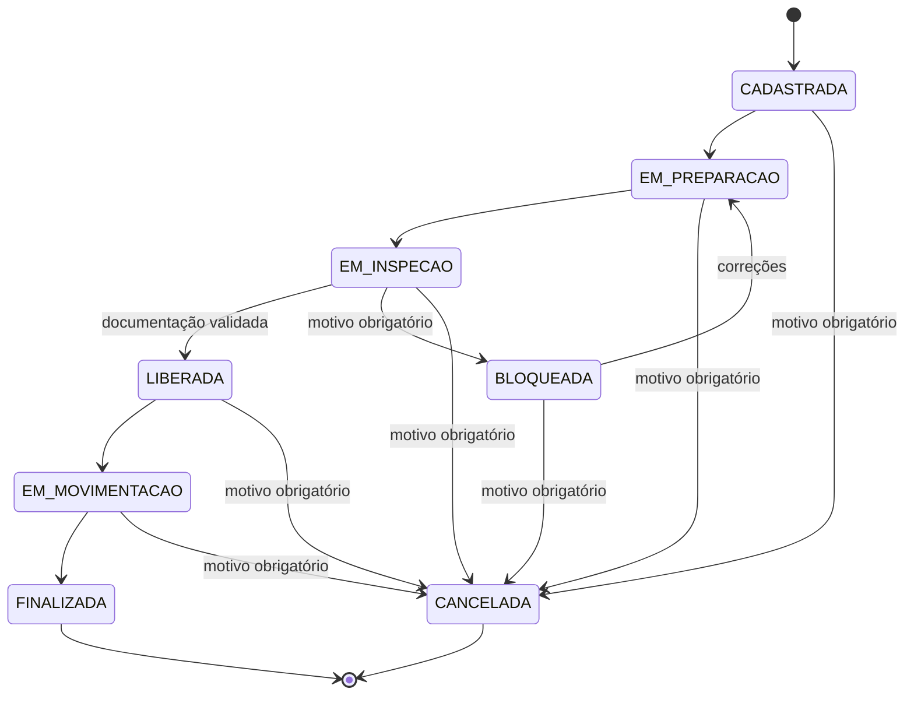

# 🧪 QuimiPort

### Sistema de Gestão de Cargas Químicas em Ambiente Portuário

> **FIAP POSTECH — Full Stack Development | Tech Challenge — Fases 1 e 2**

---

## 📑 Link para o README.MD do Backend

- [Documentação da Fase 2 (backend) README](backend/README.md)

---

## 📑 Sumário

1. [Sobre o projeto](#-sobre-o-projeto)
2. [Objetivos](#-objetivos)
3. [Contexto do problema](#-contexto-do-problema)
4. [Ciclo de vida da carga](#-ciclo-de-vida-da-carga)
5. [Status e transições](#-status-e-transições)
6. [Modelagem de domínio](#-modelagem-de-domínio)
7. [Perfis envolvidos](#-perfis-envolvidos)
8. [Visão geral da arquitetura](#-visão-geral-da-arquitetura)
9. [Estrutura do repositório](#-estrutura-do-repositório)
10. [Organização das fases do Tech Challenge](#-organização-das-fases-do-tech-challenge)
11. [Como começar](#-como-começar)
12. [Documentação complementar](#-documentação-complementar)
13. [Equipe](#-equipe)
14. [Referências](#-referências)

---

## 📋 Sobre o projeto

O **QuimiPort** é um sistema para gestão de **cargas químicas em ambiente portuário**, inspirado nas operações logísticas do Porto de Santos. Foi desenvolvido ao longo do **Tech Challenge da FIAP POSTECH**, em fases que evoluem o mesmo produto:

- **Fase 1:** definição da base técnica e arquitetural: domínio, regras de negócio, casos de uso, arquitetura e estratégia de qualidade.
- **Fase 2:** primeira versão funcional da **API backend**, com banco de dados, Docker, documentação interativa, testes automatizados e pipeline de CI.

A solução organiza e controla informações sobre **produtos químicos, cargas, classificação de risco, documentação, responsáveis, movimentações e histórico operacional**, transformando processos manuais ou descentralizados em um **fluxo controlado por regras de negócio explícitas**, com rastreabilidade e sem permitir que uma carga avance para um estado inválido.

---

## 🎯 Objetivos

O QuimiPort busca registrar, controlar e acompanhar cargas químicas portuárias. Entre os objetivos:

- cadastrar produtos químicos e controlar sua classificação de risco;
- registrar cargas químicas e associá-las aos respectivos produtos;
- controlar a documentação obrigatória;
- definir e acompanhar o responsável técnico de cada carga;
- controlar o ciclo de vida da carga, com bloqueio ou liberação conforme as regras de negócio;
- registrar o histórico das movimentações;
- restringir as ações conforme o perfil do usuário e a etapa operacional;
- preservar rastreabilidade e auditoria;
- manter uma estratégia de testes que proteja as regras críticas.

---

## ⚓ Contexto do problema

Cargas químicas exigem cuidados específicos de classificação de risco, documentação e acompanhamento técnico. Registros manuais ou dispersos dificultam confirmar se uma carga está apta a seguir para a próxima etapa, o que gera risco de movimentação indevida, perda de rastreabilidade e falhas de auditoria.

Uma carga química tem um ciclo de vida sujeito a restrições de segurança:

- uma carga sem documentação válida não pode ser liberada;
- uma carga bloqueada não pode iniciar sua movimentação;
- uma carga finalizada não pode receber novas movimentações;
- uma carga cancelada não pode voltar ao fluxo operacional;
- produtos inativos não podem ser usados em novas cargas.

Por isso, o QuimiPort não trata a carga como um simples cadastro, mas como uma entidade que percorre um **fluxo operacional controlado**.

---

## 🔄 Ciclo de vida da carga

O fluxo principal de uma carga química é:

```text
CADASTRADA
     │
     ▼
EM_PREPARACAO
     │
     ▼
EM_INSPECAO
     │
     ├──────────────► BLOQUEADA
     │                    │
     │                    ▼
     │              EM_PREPARACAO
     │
     ▼
LIBERADA
     │
     ▼
EM_MOVIMENTACAO
     │
     ▼
FINALIZADA
```

Em situações excepcionais, uma carga pode ser **cancelada antes da finalização**, desde que seja informado um motivo.

### Principais status

| Status            | Descrição                                             | Nome no enunciado da Fase 2 |
| ----------------- | ----------------------------------------------------- | --------------------------- |
| `CADASTRADA`      | Estado inicial da carga                               | Registrada                  |
| `EM_PREPARACAO`   | Preparação técnica e documental                       | Em análise                  |
| `EM_INSPECAO`     | Carga aguardando análise de qualidade                 | Em inspeção                 |
| `LIBERADA`        | Carga aprovada para movimentação                      | Liberada                    |
| `BLOQUEADA`       | Carga impedida de avançar por inconsistências         | Bloqueada                   |
| `EM_MOVIMENTACAO` | Transporte ou movimentação em andamento               | Em movimentação             |
| `FINALIZADA`      | Operação concluída (estado terminal)                  | Finalizada                  |
| `CANCELADA`       | Operação encerrada excepcionalmente (estado terminal) | Cancelada                   |

---

## 🔀 Status e transições



### Transições permitidas

| Status atual      | Pode ir para                         |
| ----------------- | ------------------------------------ |
| `CADASTRADA`      | `EM_PREPARACAO`, `CANCELADA`         |
| `EM_PREPARACAO`   | `EM_INSPECAO`, `CANCELADA`           |
| `EM_INSPECAO`     | `LIBERADA`, `BLOQUEADA`, `CANCELADA` |
| `BLOQUEADA`       | `EM_PREPARACAO`, `CANCELADA`         |
| `LIBERADA`        | `EM_MOVIMENTACAO`, `CANCELADA`       |
| `EM_MOVIMENTACAO` | `FINALIZADA`, `CANCELADA`            |
| `FINALIZADA`      | nenhum (terminal)                    |
| `CANCELADA`       | nenhum (terminal)                    |

### Transições proibidas

Qualquer combinação fora da tabela acima é proibida. Alguns exemplos:

| Tentativa                        | Motivo                                    |
| -------------------------------- | ----------------------------------------- |
| `CANCELADA` → `LIBERADA`         | Estado terminal                           |
| `FINALIZADA` → `EM_MOVIMENTACAO` | Estado terminal                           |
| `BLOQUEADA` → `EM_MOVIMENTACAO`  | Carga bloqueada não entra em movimentação |
| `CADASTRADA` → `FINALIZADA`      | Etapas puladas                            |
| `EM_INSPECAO` → `FINALIZADA`     | A carga precisa passar por `LIBERADA`     |
| `LIBERADA` → `CADASTRADA`        | Não há retorno ao início                  |

### Condições das transições

| Regra                                    | Descrição                                                                                            |
| ---------------------------------------- | ---------------------------------------------------------------------------------------------------- |
| **Liberar** (`EM_INSPECAO` → `LIBERADA`) | Exige todos os documentos obrigatórios registrados e validados                                       |
| **Bloquear** e **cancelar**              | Exigem um motivo, que fica registrado no histórico                                                   |
| **Toda transição válida**                | Gera exatamente uma movimentação, com o próximo `step`, o status anterior e o usuário que a executou |
| **Estados terminais**                    | `FINALIZADA` e `CANCELADA` não admitem novas alterações                                              |

---

## 🧩 Modelagem de domínio

A modelagem utiliza conceitos de **Domain Driven Design (DDD)**. O agregado principal é a **`CargaQuimica`**, que concentra as decisões que precisam permanecer consistentes ao longo do fluxo operacional.

### Invariantes protegidos pelo agregado

- toda carga possui produto, quantidade, unidade de medida, origem, destino e responsável técnico;
- novas cargas só podem usar produtos ativos;
- a classificação de risco da carga é herdada do produto;
- o produto só pode ser alterado enquanto a carga está `CADASTRADA`;
- toda transição válida gera uma movimentação;
- estados terminais não permitem novas movimentações;
- a liberação depende da documentação obrigatória validada.

### Principais entidades

| Entidade         | Responsabilidade                                                        | Situação na Fase 2                                              |
| ---------------- | ----------------------------------------------------------------------- | --------------------------------------------------------------- |
| `ProdutoQuimico` | Catálogo de produtos, com classe de risco ONU e status ativo ou inativo | Implementada                                                    |
| `CargaQuimica`   | Agregado principal: dados da carga, status e responsável técnico        | Implementada                                                    |
| `Movimentacao`   | Histórico cronológico das mudanças de status da carga                   | Implementada                                                    |
| `DocumentoCarga` | Documentos exigidos para a liberação e seu estado de validação          | Implementada                                                    |
| `Inspecao`       | Decisão de inspeção sobre a carga                                       | Tabela criada; a inspeção é expressa pelas transições de status |
| `Usuario`        | Quem executa as ações, com seus perfis                                  | Implementada (autenticação e autorização)                       |

### Objetos de valor

Previstos na Fase 1: `ClasseRiscoONU`, `Quantidade`, `UnidadeMedida`, `Destino`, `StatusCarga`, `Auditoria` e `Motivo`. Na Fase 2, parte deles é representada por **enums** e por **validações dos DTOs**.

A modelagem completa (linguagem ubíqua, regras, casos de uso) está na [documentação técnica da Fase 1](./docs/documentacao_tecnica.md).

---

## 👥 Perfis envolvidos

| Perfil                       | Perfil no sistema | Responsabilidade                                                                          |
| ---------------------------- | ----------------- | ----------------------------------------------------------------------------------------- |
| **Administrador**            | `ADMINISTRADOR`   | Administração geral, gestão de usuários e acesso a todas as etapas da carga               |
| **Gestor operacional**       | `GESTOR`          | Acompanhamento e condução de todas as etapas; pode cancelar cargas                        |
| **Operador portuário**       | `OPERADOR`        | Registro de cargas e atuação nas etapas de liberação e movimentação                       |
| **Responsável técnico**      | `TECNICO`         | Preparação e correção técnica das cargas; é o usuário designado como responsável da carga |
| **Analista de documentação** | `DOCUMENTACAO`    | Organização e registro dos documentos obrigatórios                                        |
| **Analista de qualidade**    | `QUALIDADE`       | Realização da inspeção                                                                    |
| **Inspetor responsável**     | `INSPETOR`        | Validação das informações e dos documentos durante a inspeção                             |

As permissões por rota e por etapa estão descritas no [README do backend](./backend/README.md#-autenticação-e-autorização).

---

## 🏗️ Visão geral da arquitetura

O QuimiPort é um **monólito modular em TypeScript**, organizado em camadas. A escolha reduz a complexidade operacional inicial, mantém fronteiras claras entre as responsabilidades e permite extrair módulos para serviços independentes quando houver necessidade concreta.

```text
┌─────────────────────────────────────┐
│          Apresentação / API         │
├─────────────────────────────────────┤
│             Aplicação               │
├─────────────────────────────────────┤
│              Domínio                │
├─────────────────────────────────────┤
│           Infraestrutura            │
└─────────────────────────────────────┘
```

| Camada             | Responsabilidade                                                     |
| ------------------ | -------------------------------------------------------------------- |
| **Apresentação**   | API REST, controllers, validação de entrada e serialização           |
| **Aplicação**      | Casos de uso, autorização, transações e coordenação das regras       |
| **Domínio**        | Regras de negócio e contratos, sem dependência de framework ou banco |
| **Infraestrutura** | Persistência, segurança, logs e configurações                        |

Na **Fase 2**, a arquitetura foi implementada com **NestJS**, **PostgreSQL** e **Prisma**. A estrutura interna, os módulos e as decisões técnicas estão no [README do backend](./backend/README.md).

---

## 🗂️ Estrutura do repositório

```text
Tech-Challenge-QuimiPort/
├── .docker/
│   └── Dockerfile                  # Imagem da API
├── .github/
│   └── workflows/
│       └── ci.yml                  # Pipeline de CI (GitHub Actions)
├── .vscode/
│   └── launch.json                 # F5 executa a API em modo de desenvolvimento
├── backend/                        # API da Fase 2 (veja backend/README.md)
│   ├── prisma/                     # Schema e migrations
│   ├── src/                        # Código-fonte
│   ├── test/                       # Configuração de testes e2e
│   └── README.md                   # Documentação técnica do backend
├── docs/                           # Documentação da Fase 1
│   ├── diagramas/
│   │   ├── 4.5_diagrama_de_dominio.md
│   │   ├── 4.7_mapa_de_contexto.md
│   │   ├── 6.1_diagrama_de_casos_de_uso.md
│   │   ├── 7.1_diagrama_de_transicao.md
│   │   ├── 8.3_diagrama_de_arquitetura.md
│   │   ├── 8.5_contexto_de_aplicacao.md
│   │   └── 10.3_piramide_de_testes.md
│   ├── QuimiPort_Apresentacao.pptx
│   ├── documentacao_tecnica.md
│   └── fase_1.md
├── docker-compose.yml              # API + PostgreSQL
├── docker-compose-db-only.yml      # Alternativa: somente o banco
├── .nvmrc                          # Versão do Node.js
└── README.md                       # Este arquivo
```

---

## 🎓 Organização das fases do Tech Challenge

| Fase               | Foco                                                                                                                               | Onde está                         |
| ------------------ | ---------------------------------------------------------------------------------------------------------------------------------- | --------------------------------- |
| **Fase 1**         | Proposta técnica e arquitetural: domínio, DDD, regras de negócio, casos de uso, arquitetura, TypeScript e qualidade                | [`docs/`](./docs/)                |
| **Fase 2**         | Primeira versão da API backend: API REST, banco de dados, Docker, documentação da API, testes automatizados e CI                   | [`backend/`](./backend/README.md) |
| **Próximas fases** | Evolução prevista: interface web, armazenamento de documentos, notificações, integrações e outras capacidades planejadas na Fase 1 | —                                 |

### Da Fase 1 para a Fase 2

A Fase 2 implementa parte do planejamento da Fase 1. As diferenças de nomenclatura e de escopo são:

| Tema                    | Fase 1 / enunciado                                    | Implementação na Fase 2                                                                                      |
| ----------------------- | ----------------------------------------------------- | ------------------------------------------------------------------------------------------------------------ |
| Nomes dos status        | O enunciado cita "Registrada" e "Em análise"          | `CADASTRADA` corresponde a **Registrada** e `EM_PREPARACAO` a **Em análise**; os demais mantêm o nome        |
| Transições adicionais   | O enunciado lista o fluxo principal e os alternativos | Mantidas as transições da Fase 1: `BLOQUEADA` → `EM_PREPARACAO` (correção) e `EM_MOVIMENTACAO` → `CANCELADA` |
| Responsável técnico     | Atribuído em etapa posterior                          | Informado **no cadastro**, como usuário ativo com perfil `TECNICO`                                           |
| Código da carga         | Campo de identificação                                | Derivado do identificador do banco (`CQ-000001`)                                                             |
| Exclusão de carga       | Não prevista                                          | Substituída pelo **cancelamento lógico**                                                                     |
| Documentos obrigatórios | Catálogo deixado em aberto                            | `FISPQ` e `NOTA_FISCAL`                                                                                      |
| Arquitetura             | Portas e adaptadores, com repositórios                | Services com Prisma direto; repositórios ficam como evolução                                                 |
| Inspeção                | Entidade `Inspecao`                                   | Tabela criada; a inspeção é expressa pelas transições `EM_INSPECAO` → `LIBERADA` ou `BLOQUEADA`              |

---

## 🚀 Como começar

O caminho mais curto para ver a API funcionando é o Docker. Com o **Docker Desktop aberto**, na raiz do repositório:

```bash
cp backend/.env.docker.example backend/.env.docker   # preencha os valores
docker compose up -d --build
```

No Windows (prompt de comando), use `copy backend\.env.docker.example backend\.env.docker`.

Quando a API estiver pronta, a documentação interativa (Swagger) fica em **http://localhost:3000/api/api-docs**.

Execução local para desenvolvimento, variáveis de ambiente, testes, endpoints e solução de problemas estão no **[README do backend](./backend/README.md)**.

---

## 📚 Documentação complementar

| Recurso                                                                         | Descrição                                                                                                                   |
| ------------------------------------------------------------------------------- | --------------------------------------------------------------------------------------------------------------------------- |
| 🖥️ [README do backend](./backend/README.md)                                     | Documentação técnica da API: execução, configuração, banco de dados, endpoints, testes, CI e decisões                       |
| 📄 [Documentação técnica e arquitetural](./docs/documentacao_tecnica.md)        | Domínio, linguagem ubíqua, modelagem DDD, regras de negócio, casos de uso, arquitetura e planejamento de qualidade (Fase 1) |
| 🧩 [Diagrama de domínio](./docs/diagramas/4.5_diagrama_de_dominio.md)           | Entidades, agregados e relacionamentos                                                                                      |
| 🗺️ [Mapa de contexto](./docs/diagramas/4.7_mapa_de_contexto.md)                 | Contexto delimitado e integrações externas previstas                                                                        |
| 👥 [Diagrama de casos de uso](./docs/diagramas/6.1_diagrama_de_casos_de_uso.md) | Casos de uso e atores                                                                                                       |
| 🔄 [Diagrama de transição](./docs/diagramas/7.1_diagrama_de_transicao.md)       | Fluxo de status da carga                                                                                                    |
| 🏗️ [Diagrama de arquitetura](./docs/diagramas/8.3_diagrama_de_arquitetura.md)   | Camadas e responsabilidades                                                                                                 |
| 🌐 [Contexto da aplicação](./docs/diagramas/8.5_contexto_de_aplicacao.md)       | Contexto de aplicação                                                                                                       |
| 🔺 [Pirâmide de testes](./docs/diagramas/10.3_piramide_de_testes.md)            | Estratégia de testes                                                                                                        |
| 🎥 [Vídeo da Fase 1](https://youtu.be/Wdpwq6Uye4E)                              | Apresentação da proposta técnica                                                                                            |

> 🎥 **Vídeo da Fase 2:** _(adicionar o link após a gravação)_

---

## 👨‍💻 Equipe

- **Bruno de Almeida Dias**
- **Adriel de Sousa Ribeiro**
- **Nasser Ferreira Tarraf**
- **Glauton Feitosa da Silva**

**Professor:** Israel Meinert

**Instituição:** FIAP POSTECH
**Curso:** Full Stack Development
**Turma:** 10FSDT

---

## 📄 Referências

Este projeto foi desenvolvido com base nos enunciados oficiais do **Tech Challenge — Fases 1 e 2 — Full Stack Development** da FIAP POSTECH e na documentação técnica elaborada pela equipe.
